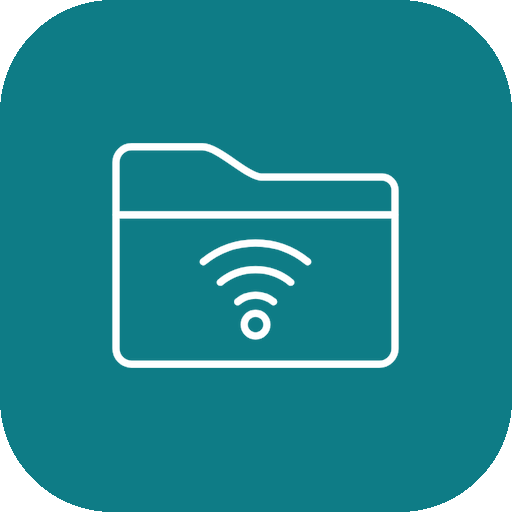

  

<h1 align="center">WiFi FTP Server</h1>

Transfer files between your Android phone and other devices over Wi-Fi.

  
  
  

## Features

- Transfer files over Wi-Fi using FTP.
- Optional FTPS encryption (explicit or implicit mode).
- Password-protected login or optional anonymous access.
- Read-only mode to prevent changes to shared files.
- Share internal storage or choose a folder.
- Background server with a persistent notification and Stop action.
- View connection details and connected clients in the app.
- Light, dark, and system themes.
- No ads, analytics, or tracking.

## Download

Download the latest APK from the [GitHub Releases page](https://github.com/syedarmarz/wifi-ftp-server/releases).

**Requirements:** Android 8.0 (API 26) or newer.

1. Download the APK to your Android phone.
2. Open the APK and allow installation from your browser or file manager if Android asks.
3. Open **WiFi FTP Server**.

The app requires the Android **all files access** permission to share the folders you select.

## Get started

1. Connect your phone and the other device to the same Wi-Fi network, or enable your phone's hotspot.
2. Open the app and tap **START**. Grant file access when prompted.
3. Note the **Server URL**, **Userid**, and **Password** shown in the app.
4. Enter those details in an FTP client on the other device.

The app creates a password when it is first opened. You can change it in **Settings**.

## Security

- Standard FTP does not encrypt passwords or file transfers. Use FTPS when you need an encrypted connection.
- FTPS uses a self-signed certificate generated by the app. Your FTP client may ask you to trust that certificate.
- Use the server only on networks you trust. Avoid public Wi-Fi.
- Enable **Read only** when other devices only need to download files.
- Stop the server when you have finished transferring files.

## Troubleshooting

**The other device cannot connect:** Make sure both devices are on the same network. Some guest networks block communication between devices (AP isolation). Check the server address, port, username, and password.

**The shared folder is empty or uploads fail:** Check that **all files access** is enabled for the app, then restart the server.

**The selected port is already in use:** Choose another port in **Settings**.

**The server stops in the background:** Set the app's battery usage to **Unrestricted** in Android settings.

## Privacy

The app does not use accounts, ads, analytics, or tracking. Files are transferred between your phone and the devices that connect to your server.

## License

WiFi FTP Server is proprietary software. You may download, install, and use an official, unmodified release for personal, non-commercial use, subject to the terms in [LICENSE.txt](LICENSE.txt). No permission is granted to modify, redistribute, sell, or reuse the software or its source code. All rights are reserved by the copyright owner.

Copyright (c) 2026 Syed Armarz. All rights reserved.
